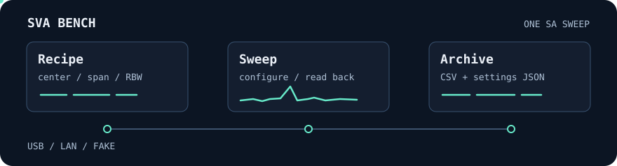
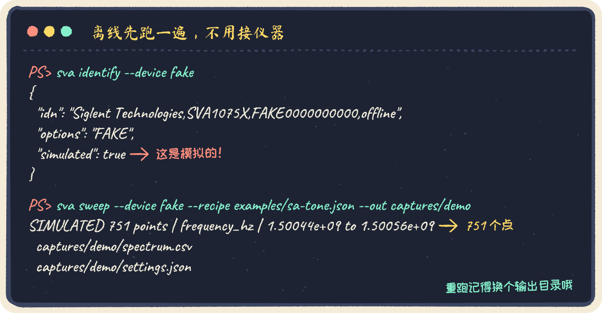

# SVA Bench 🐶

<p align="center">
  
</p>

**一句话：** 给一份 JSON "配方"，它就替你指挥 SIGLENT SVA 频谱仪扫一条频谱（或零扫宽）迹线，顺手把仪器**实际**用了什么设置也记下来。

走 USB 或 LAN 都行。手边没仪器？有离线模拟模式，先玩起来再说。另外它还能接进 RadioScope 的有线发射实验。



## 1. 安装

要 Python 3.10 或更高。目前是 **Alpha**，能用，但别指望它已经百炼成钢。

**方式 A：克隆（推荐）。** 配方和文档会一起下载下来。

```powershell
git clone https://github.com/foreverfine77/sva-bench.git
Set-Location sva-bench
python -m pip install .
```

**方式 B：下载 ZIP。** 去 [GitHub Releases](https://github.com/foreverfine77/sva-bench/releases) 拿带版本号的包，解压到随便哪个工作目录，进到有 `pyproject.toml` 的那一层，跑 `python -m pip install .`。配方在 `examples/` 里。

**方式 C：已经有自己的配方了？** 直接装固定版本：

```powershell
python -m pip install "git+https://github.com/foreverfine77/sva-bench.git@v0.1.0-alpha.1"
```

## 2. 先离线跑一次

不接仪器，两条命令见真章：

```powershell
sva identify --device fake
sva sweep --device fake --recipe examples/sa-tone.json --out captures/demo
```



`fake` 会生成一条模拟迹线，`settings.json` 里会老老实实标上 `simulated: true`，不会冒充真数据。想再跑一遍？**换个输出目录**就行。

## 3. 连上真仪器

| 怎么连 | 设备参数 | 要准备什么 |
| --- | --- | --- |
| USBTMC | `--device usb`，或者完整的 VISA 资源名 | 插仪器后面板的 USB Device 口。装好系统 VISA 驱动，再在本目录执行 `python -m pip install ".[usb]"`。 |
| LAN | `--device <仪器 IP 或主机名>` | 确认仪器的 SCPI TCP 5025 端口能访问到。 |

开跑之前，先把这三件事想清楚：**信号源是谁、进仪器的功率多大、衰减开多少**。输入口比较娇气，别靠运气。

然后从"只读"开始，一步步来：

```powershell
sva identify --device usb
sva inspect --device usb
sva sweep --device usb --recipe examples/sa-tone.json --out captures/tone
sva sweep --device usb --recipe examples/sa-zero-span.json --out captures/pulse
```

- `identify` 和 `inspect` 只看不动，放心用。
- `sweep` 才会动手：应用配方 → 核对仪器读回的设置 → 采一条迹线。采完之后，仪器会停在单扫模式。
- 配方里的单位：频率是 Hz，电平是 dBm，衰减是 dB。
- 想要零扫宽？写 `span_hz: 0`，同时别忘了填 `sweep_s`。

跑完你会得到：

| 输出 | 里面有什么 |
| --- | --- |
| `spectrum.csv` | 普通扫频的横轴是 `frequency_hz`，零扫宽的横轴是 `time_s`；纵轴都是 `level_dbm`。 |
| `settings.json` | 仪器身份、你请求的设置、配置后和采集后的读回值、采集时间。 |
| `screen.bmp` | 加了 `--screenshot` 才有，顺手给仪器屏幕拍张照。 |

## 4. 接进 RadioScope

1. 用启动 RadioScope 和批次脚本的**同一个 Python 环境**安装 SVA Bench。走 USB 的话，在工具包目录运行 `python -m pip install ".[usb]"`。
2. 回到 RadioScope 根目录，让 Web 发射页保持连接，按这次实物链路做完预检。
3. 先离线看一遍计划，再按 RadioScope 的链路说明跑实物批次。

```powershell
$env:PYTHONPATH = "host"
python tools/web_instrument_batch.py --sva-driver sva-bench --sva usb --check-setup
python tools/web_instrument_batch.py --sva-driver sva-bench --profile rates-lo --limit 1 --web-full-span
```

分工很清楚：SVA Bench 管**仪器配置和采谱**；RadioScope 管**波形、TX 启停、关断核验和矩阵**。完整的实验命令在 RadioScope 的 `docs/hardware/sva-experiment-commands.md`。

## 5. 代码在哪儿看

| 模块 | 干什么的 |
| --- | --- |
| `_driver.py` | SCPI、USB/LAN 通信，以及离线的仪器模拟。导出时取自 RadioScope 的共用驱动。 |
| `measurement.py` | 打开设备、应用配方、确认读回、采迹线。 |
| `archive.py` | 把 CSV 和设置 JSON 写出来。 |
| `cli.py` | 解析命令，把"采一次"和"存档"串起来。 |

> [!NOTE]
> 目前的 Alpha 用 Fake 验证过安装、命令和 RadioScope 接入。**这个打包版本的 USB 与 LAN 实物复测还没做完。** VNA 的自动校准和 S 参数输出也留到以后再验证。

## 许可证

[MIT 许可证](LICENSE)。用、改、再分发都行，保留原版权和许可声明就好。
